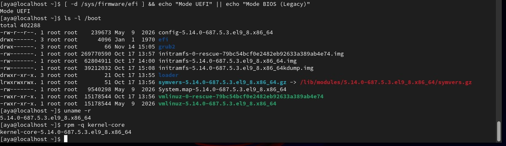
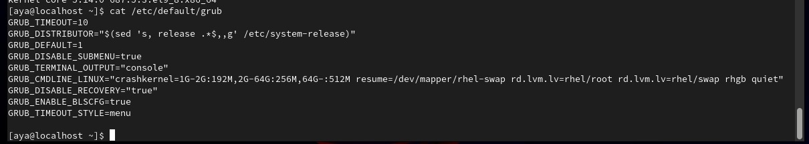
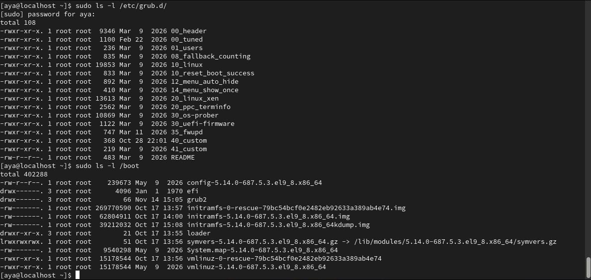
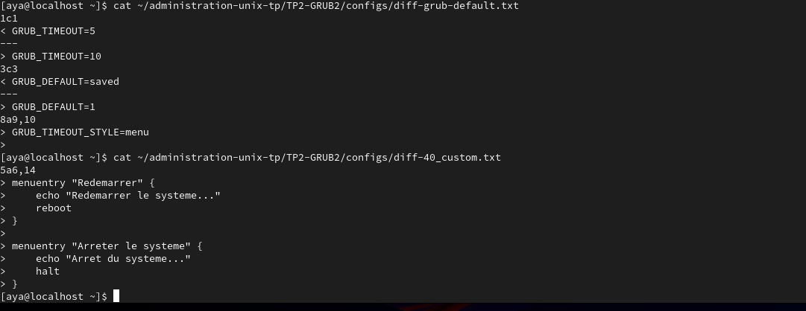
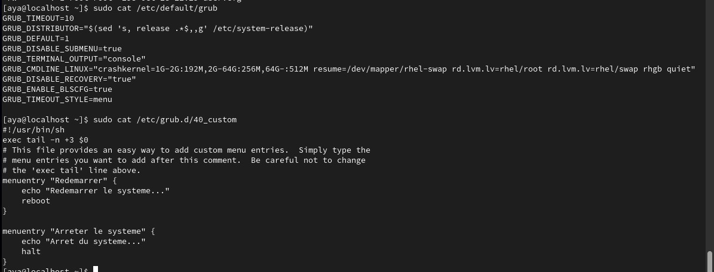
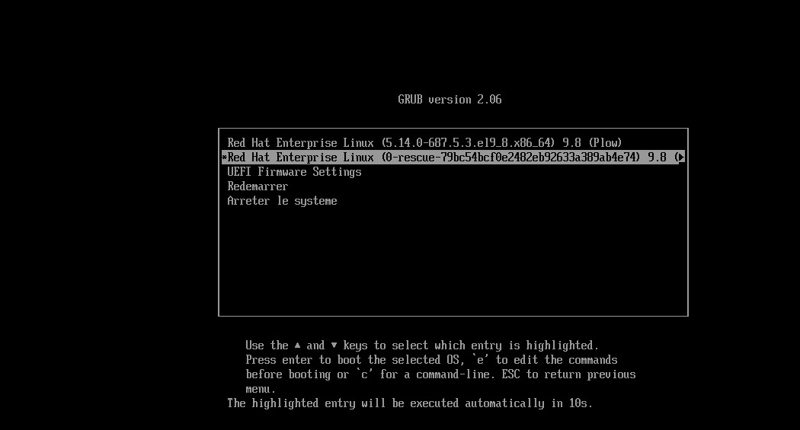

# TP2 : Configuration du Boot Loader GRUB2

**Réalisé le 28 octobre 2026** 

## 1. Objectif
Comprendre le rôle de GRUB2 et la génération de son fichier de configuration.

## 2. Rappel théorique
GRUB2 est lancé par le firmware (BIOS ou UEFI). Il affiche un menu, charge le noyau (`vmlinuz`) et l'`initramfs` en mémoire, puis donne la main au noyau avec sa ligne de commande.
On ne modifie jamais `grub.cfg` à la main : il est **généré** par `grub2-mkconfig` à partir de `/etc/default/grub` (paramètres globaux) et des scripts de `/etc/grub.d/`.

## 3. Étapes réalisées

### 3.1 Mode de démarrage, contenu de /boot et noyau
Commandes : `[ -d /sys/firmware/efi ] && echo "Mode UEFI" || echo "Mode BIOS (Legacy)"`, `ls -l /boot`, `uname -r`, `rpm -q kernel-core`

- Résultat : **Mode UEFI**. Si `/sys/firmware/efi` existe, le système a démarré en UEFI. Le fichier `/boot/efi/EFI/redhat/grub.cfg` est alors un relais vers `/boot/grub2/grub.cfg`.
- `vmlinuz-5.14.0-...` : le noyau Linux compressé.
- `initramfs-5.14.0-...img` : système de fichiers racine temporaire utilisé au démarrage.
- `loader/` : entrées de démarrage au format BLS (une par noyau).
- `grub2/` : `grubenv`, polices, `grub.cfg`.
- `uname -r` donne le noyau **en cours d'exécution** ; `rpm -q kernel-core` donne les noyaux **installés** : `5.14.0-687.5.3.el9_8.x86_64`.

### 3.2 Analyse de /etc/default/grub
Commande : `cat /etc/default/grub`

| Variable | Rôle |
|---|---|
| `GRUB_TIMEOUT` | durée d'affichage du menu avant démarrage automatique |
| `GRUB_DEFAULT` | entrée par défaut (`saved` = lue dans grubenv) |
| `GRUB_CMDLINE_LINUX` | paramètres ajoutés à la ligne de commande du noyau |
| `GRUB_ENABLE_BLSCFG` | utiliser la Boot Loader Specification |
| `GRUB_TIMEOUT_STYLE` | `menu` force l'affichage du menu |

### 3.3 Scripts de /etc/grub.d
Commande : `sudo ls -l /etc/grub.d/`

`grub2-mkconfig` exécute ces scripts dans l'ordre alphabétique :
- `00_header` : variables de base (entrée par défaut, délai, terminal)
- `01_users` : prise en compte du mot de passe défini avec `grub2-setpassword`
- `10_linux` : entrées des noyaux (via `blscfg`)
- `30_uefi-firmware` : accès à la configuration du firmware UEFI
- `40_custom` : entrées de menu personnalisées

(`sudo` est nécessaire car ce dossier est réservé à root.) La même capture montre aussi `sudo ls -l /boot`.

### 3.4 Sauvegardes puis modifications
Avant de modifier, j'ai sauvegardé les fichiers (`cp -p`) car une erreur dans GRUB peut empêcher le démarrage : `/etc/default/grub`, `40_custom` et `grub.cfg`.

Modifications faites (voir `configs/diff-grub-default.txt`) :

| Variable | Avant | Après |
|---|---|---|
| `GRUB_TIMEOUT` | 5 | 10 |
| `GRUB_DEFAULT` | saved | 1 (2e entrée du menu) |
| `GRUB_TIMEOUT_STYLE` | absente | menu |

### 3.5 Entrées personnalisées dans 40_custom
Ajout de deux entrées qui utilisent les commandes internes de GRUB : `reboot` et `halt`.
Contenu visible sur la capture (`sudo cat /etc/grub.d/40_custom`) et dans `configs/40_custom.modifie`. La capture montre aussi `/etc/default/grub` avec les valeurs modifiées.

### 3.6 Régénération de grub.cfg
Commande : `grub2-mkconfig -o /boot/grub2/grub.cfg`

Modifier `/etc/default/grub` ne change rien tant que `grub.cfg` n'est pas régénéré. Après redémarrage, le menu reste 10 s et affiche « Redemarrer » et « Arreter le systeme ».

### 3.7 Réinitialisation du mot de passe root
Principe : dans GRUB, touche `e` sur l'entrée, ajout de `rd.break` à la ligne `linux`, puis `Ctrl+x`. Le démarrage s'arrête dans l'initramfs avant systemd. Ensuite :

~~~
mount -o remount,rw /sysroot
chroot /sysroot
passwd
touch /.autorelabel
exit
exit
~~~

- `/sysroot` est monté en lecture seule : il faut le remonter en écriture.
- `chroot` fait de `/sysroot` la racine, pour que `passwd` modifie le vrai `/etc/shadow`.
- `/.autorelabel` force le réétiquetage SELinux, car `passwd` recrée `/etc/shadow` sans contexte SELinux.

### 3.8 Protection de GRUB par mot de passe
Commande : `grub2-setpassword` (hash PBKDF2 stocké dans `/boot/grub2/user.cfg`), puis `grub2-mkconfig`.

Sans protection, quiconque a accès à la console peut démarrer en mode mono-utilisateur et devenir root, modifier la configuration GRUB ou démarrer un autre OS sans contrôle d'accès. Après protection, la touche `e` demande un login et un mot de passe. Pour la retirer : supprimer `user.cfg`.
Le fichier `user.cfg` n'est volontairement pas versionné (il contient un hash de mot de passe).

## 4. Conclusion
`grub.cfg` est un fichier **généré** (jamais édité directement) ; la configuration vient de `/etc/default/grub` et de `/etc/grub.d/` ; GRUB est un point d'entrée sensible qu'il faut protéger par mot de passe.
