# TP3 : Configuration des cibles et gestion des services par systemd

## Atelier 1 : Bases de systemd et systemctl

### 1.1 Vérifier que le système utilise systemd
Commandes : `systemctl --version` et `ps aux | head -2`

Le processus de PID 1 est `/usr/lib/systemd/systemd` : c'est le premier processus lancé par le noyau, il démarre et supervise tous les autres. Le système fonctionne donc avec systemd.

### 1.2 Emplacement des fichiers
Commandes : `whereis systemd` et `whereis systemctl`

Les binaires et unités sont dans `/usr/lib/systemd`, la configuration dans `/etc/systemd`, et l'outil `systemctl` dans `/usr/bin/systemctl`.

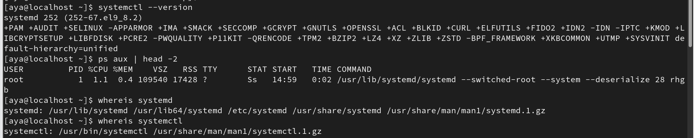

### 1.3 Temps de démarrage et services les plus lents
Commandes : `systemd-analyze` et `systemd-analyze blame`

Démarrage total : 25,2 s = 6,6 s (noyau) + 4,4 s (initrd) + 14,2 s (userspace). Le service le plus lent est `kdump.service` (6,96 s, capture des plantages du noyau). Les autres entrées sont des périphériques virtuels détectés au démarrage (ports série, disque NVMe).

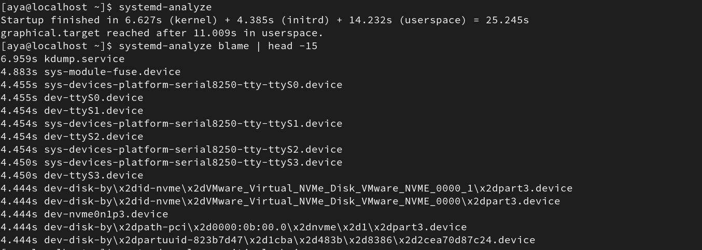

### 1.4 Chaîne critique
Commande : `systemd-analyze critical-chain`

Elle montre les unités qui déterminent le temps de démarrage, de `graphical.target` jusqu'à `journald`. `@` indique l'instant d'activation, `+` la durée de démarrage de l'unité. Ici, `plymouth-quit-wait.service` (+3,85 s) est le maillon le plus long avant `multi-user.target`. Utile pour diagnostiquer un démarrage lent.

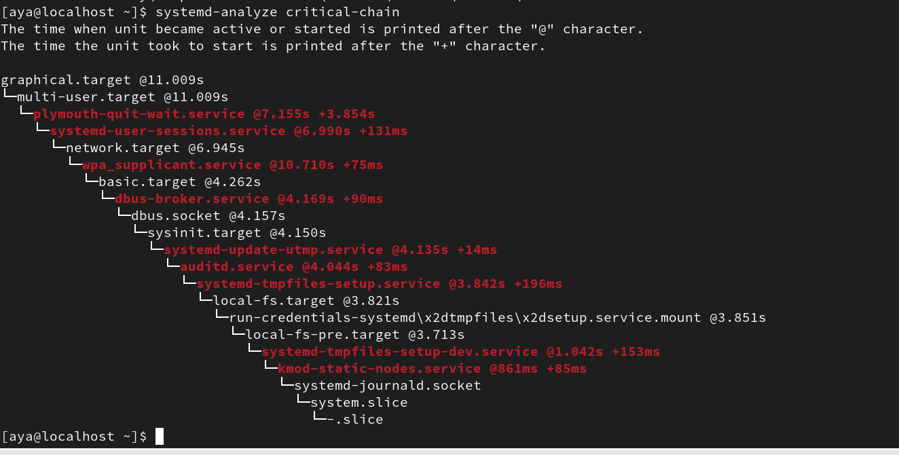

## Atelier 2 : Configurer les cibles systemd

Une **cible** (target) regroupe des unités et correspond à un état du système (ancien « niveau d'exécution »). Les anciennes commandes `runlevel` et `telinit` sont remplacées par `systemctl list-units --type target` et `systemctl isolate`.

### 2.1 Cible par défaut
Commande : `systemctl get-default`

Résultat : `graphical.target`. La commande résout le lien symbolique `/etc/systemd/system/default.target`.

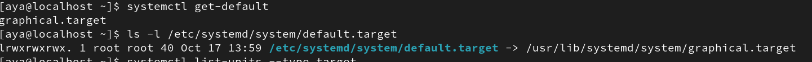

### 2.2 Cibles actuellement chargées
Commande : `systemctl list-units --type target`

Affiche chaque cible avec ses colonnes LOAD, ACTIVE, SUB et DESCRIPTION.

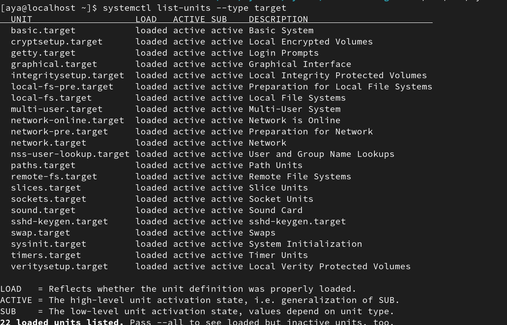

### 2.3 Modifier la cible par défaut
Commande : `sudo systemctl set-default multi-user.target`, puis retour à `graphical.target`

La commande remplace le lien `/etc/systemd/system/default.target` par un lien vers la cible choisie. Elle ne change rien à la session en cours, seulement au prochain démarrage. J'ai remis `graphical.target` ensuite.

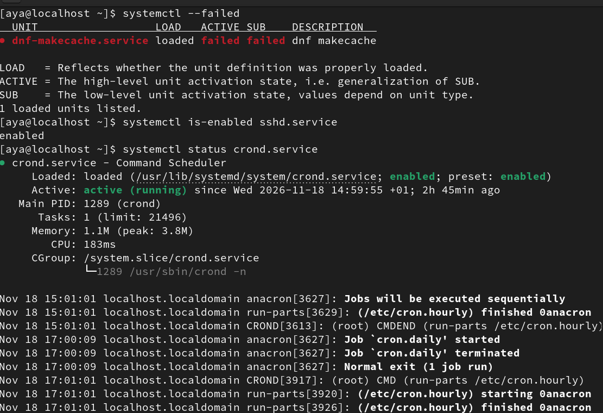

### 2.4 Modifier la cible actuelle
Commandes : `systemctl isolate multi-user.target` et `systemctl rescue`

`isolate` active la cible indiquée avec ses dépendances et arrête immédiatement toutes les autres : avec `multi-user.target`, l'interface graphique est coupée. `rescue` passe en mode secours (session coupée, mot de passe root demandé).

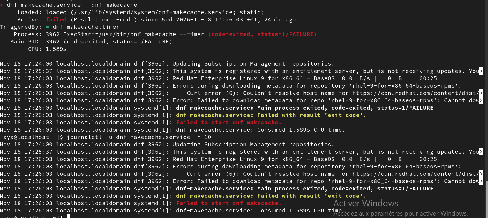

### 2.5 Unités défaillantes, état d'un service
Commandes : `systemctl --failed`, `systemctl is-enabled sshd.service`, `systemctl status crond.service`

`--failed` liste les unités en échec. `is-enabled` indique si un service démarre au boot. `status` indique s'il tourne (`active (running)`), son PID et ses derniers logs.

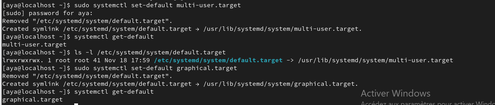
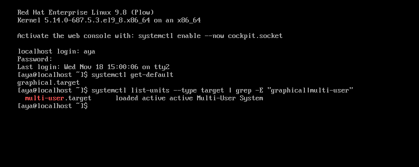

## Atelier 3 : Gestion des services par systemctl

### 3.1 Lister les services
Commande : `systemctl list-unit-files --type=service`

Affiche chaque service avec son état (`enabled`, `disabled`, `static`, `alias`) et son état par défaut (`PRESET`).

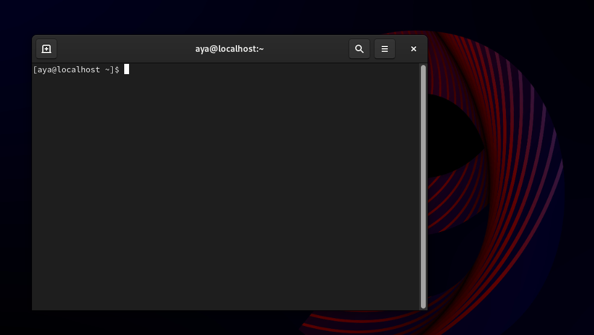

### 3.2 Statut de sshd et vérification de crond
Commandes : `systemctl status sshd.service`, `systemctl is-active crond.service`

`sshd` est `active (running)` avec son PID principal. `crond` est `active`.

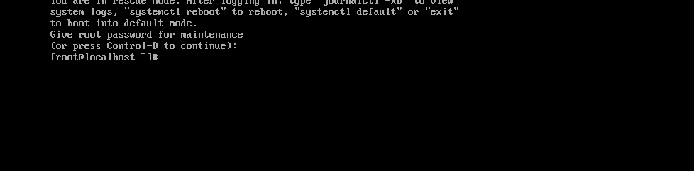
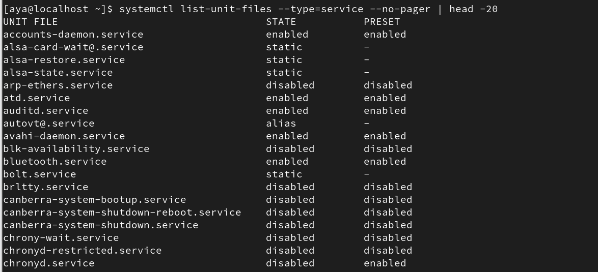

### 3.3 Redémarrer, recharger, arrêter, démarrer sshd
Commandes : `sudo systemctl restart|reload|stop|start sshd.service`

- `restart` : arrêt puis démarrage (le PID change).
- `reload` : sshd relit sa configuration sans s'arrêter (signal SIGHUP, message `Received SIGHUP; restarting`).
- `stop` : arrêt propre (signal 15), `status` affiche `inactive (dead)`.
- `start` : le service redémarre, `is-active` répond `active`.

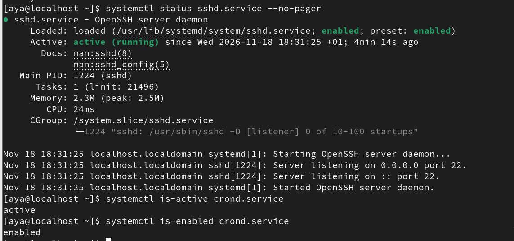
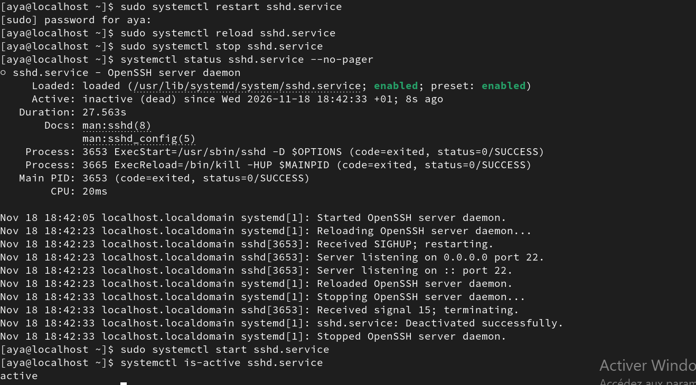

### 3.4 enable et disable (service crond)
Commandes : `sudo systemctl disable crond.service`, `systemctl is-enabled crond.service`, `sudo systemctl enable crond.service`

`disable` supprime le lien symbolique `/etc/systemd/system/multi-user.target.wants/crond.service` : le service ne démarrera plus au boot, mais il continue de tourner (`is-active` reste `active`). `enable` recrée ce lien. `start` et `stop` agissent sur l'état actuel, `enable` et `disable` sur le prochain démarrage.

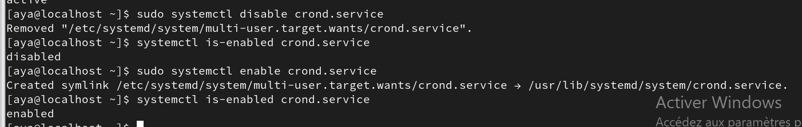

### 3.5 mask et unmask
Commandes : `sudo systemctl mask httpd.service`, `sudo systemctl start httpd.service`, `sudo systemctl unmask httpd.service`

`mask` relie l'unité à `/dev/null`. Ensuite, `start` échoue avec `Unit httpd.service is masked`. `httpd` n'était pas installé, mais le masquage fonctionne quand même. `mask` est plus fort que `disable` : plus rien ne peut lancer le service, même manuellement. `unmask` supprime le lien.

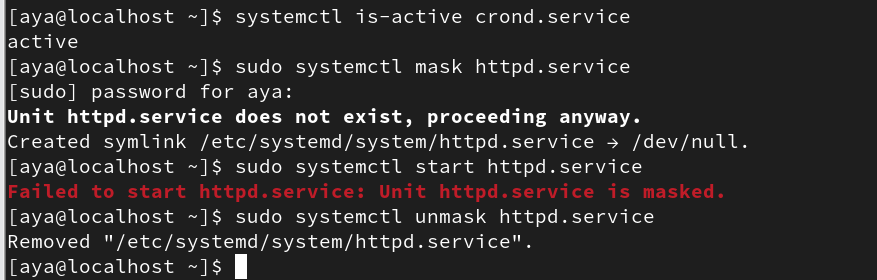

### 3.6 Envoyer un signal à un service
Commande : `sudo systemctl kill sshd`

Envoie SIGTERM (par défaut) aux processus du service (`Sent signal SIGTERM ... on client request`). `status` affiche `inactive (dead)`. Différence avec `stop` : `kill` envoie directement un signal, utile pour un service bloqué. Le service a ensuite été relancé avec `start`.

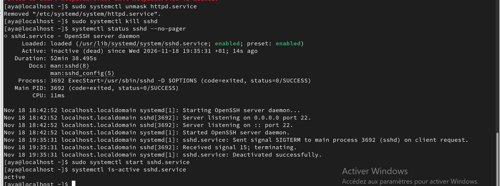

## Atelier 4 : Journalisation avec journalctl

`journalctl` lit le journal centralisé de systemd.

| Commande | Rôle |
|---|---|
| `journalctl -b` | logs depuis le dernier démarrage |
| `journalctl -u sshd.service` | logs d'un seul service |
| `journalctl -p err` | messages de priorité erreur ou plus grave |
| `journalctl --since "today"` | logs depuis minuit |
| `journalctl -n 20` | les 20 dernières entrées |
| `journalctl -o json-pretty` / `-o cat` | formats de sortie |
| `journalctl -f` | suivi en direct |

### 4.1 Démarrage et service sshd
Le premier message de `-b` donne la version du noyau (`5.14.0-687.5.3.el9_8`) et sa ligne de commande : la VM a démarré sur l'entrée **rescue**, conséquence de `GRUB_DEFAULT=1` du TP2 (2e entrée du menu). `-u sshd.service` retrace toutes mes actions : arrêts, démarrages et le `SIGTERM` du `kill`.

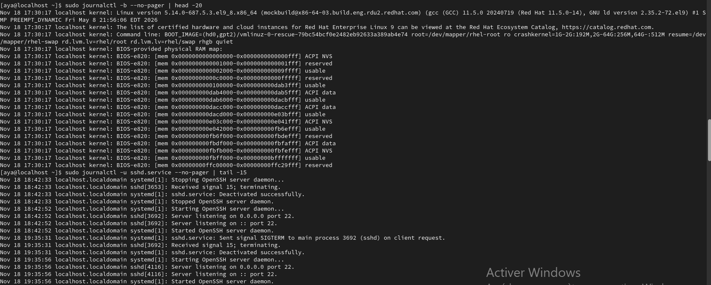

### 4.2 Priorité, date, nombre d'entrées
`-p err` montre surtout des avertissements de pilotes obsolètes (`cnic`, `bnx2i`) et des erreurs de l'interface GNOME, courants dans une VM. `--since "today"` et `-n 20` montrent aussi mes propres commandes `journalctl`, car `sudo` journalise chaque commande (`COMMAND=...`).

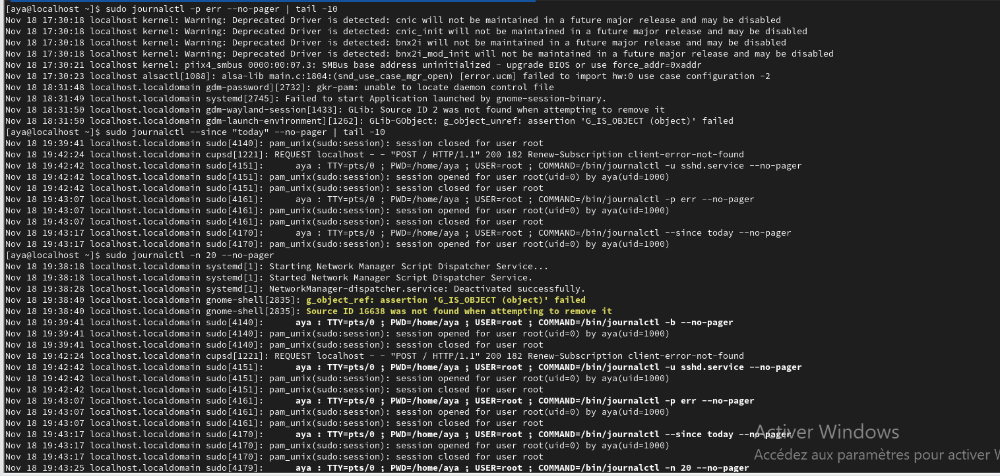

### 4.3 Formats de sortie
`-o json-pretty` affiche une entrée avec toutes ses métadonnées (`_PID`, `UNIT`, `MESSAGE`, `PRIORITY=6` soit info). `-o cat` n'affiche que le texte du message.

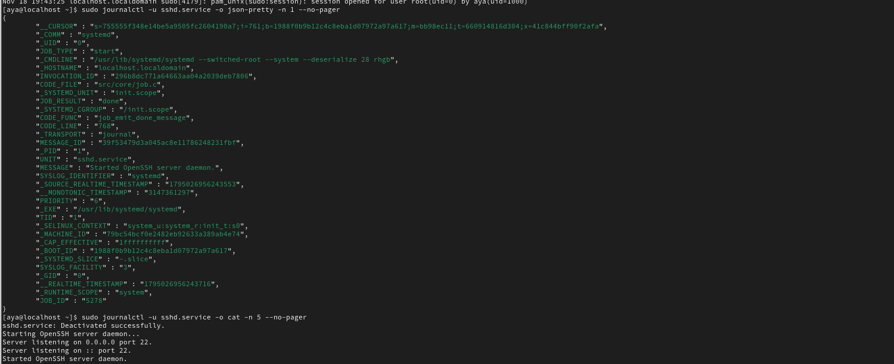

### 4.4 Suivi en direct (-f)
`journalctl -f` reste en attente et affiche les nouveaux logs au fil de l'eau (arrêt avec `Ctrl+C`). Depuis un second terminal, `sudo ls /root` a fait apparaître la ligne `COMMAND=/bin/ls /root`, et `sudo systemctl restart sshd.service` a fait apparaître `Stopping`, `Stopped`, `Starting`, `Started` dans `journalctl -u sshd.service -f`.

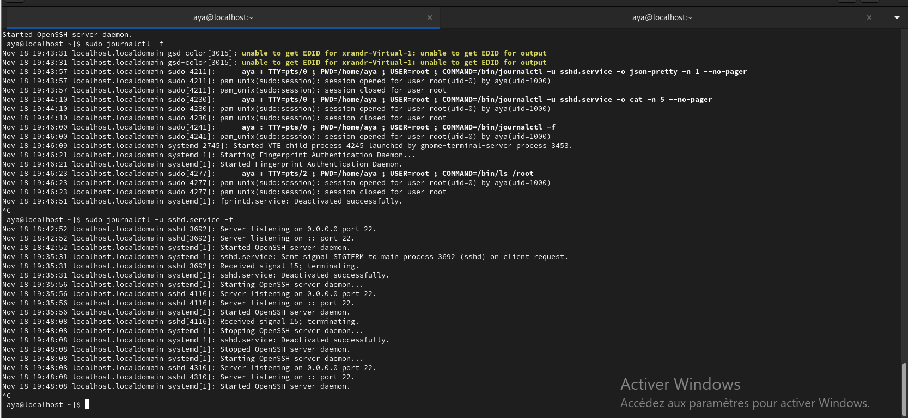

## Conclusion
systemd est le premier processus (PID 1) qui gère le démarrage par **cibles** et les processus par **unités**. `systemctl` pilote l'état immédiat des services (`start`, `stop`, `reload`, `kill`) et leur démarrage automatique (`enable`, `disable`, `mask`). `journalctl` permet de diagnostiquer grâce aux logs centralisés.
